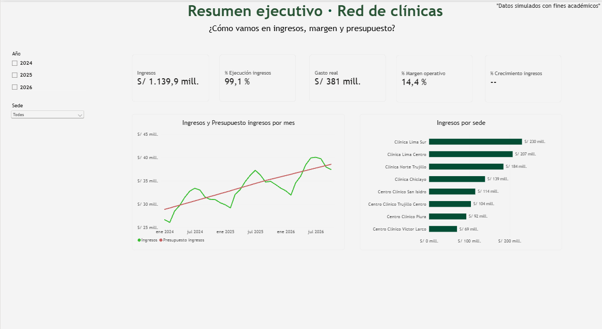
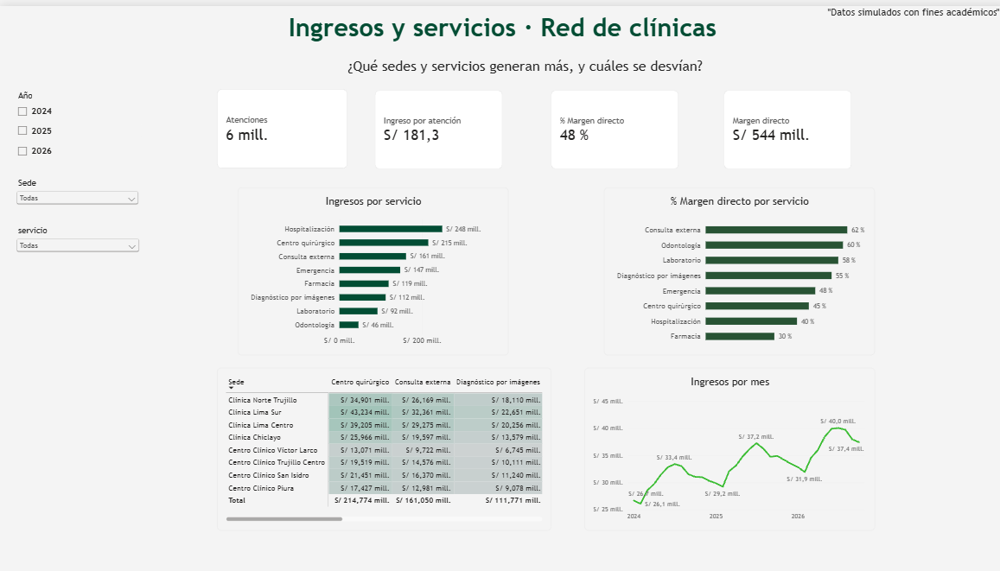
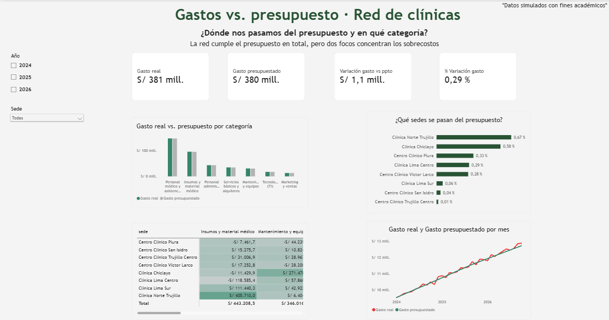
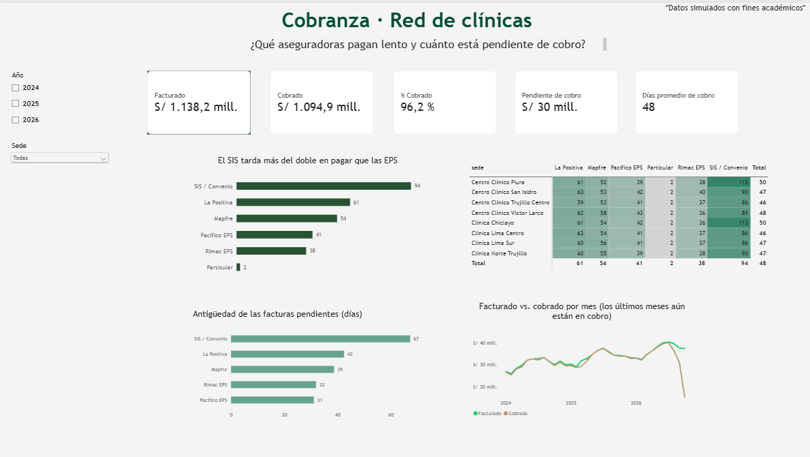
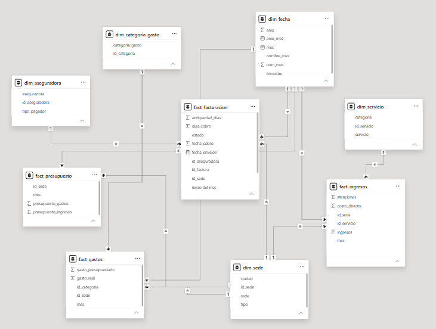

# Proyecto BI: Dashboard financiero de una red de clínicas

Dashboard de Power BI de 4 páginas para el área de Finanzas de una **red ficticia de 8 clínicas** (Trujillo, Lima, Chiclayo y Piura). Controla ingresos, gastos, presupuesto y cobranza entre enero de 2024 y octubre de 2026.

> **Todos los datos son simulados.** No se usó información real de ninguna organización, paciente ni empleado.

**[Ver el dashboard publicado](https://app.powerbi.com/view?r=eyJrIjoiOGZhY2NkOTctZGQ5ZC00NmYwLTk3YTMtOGM3MWQ3ZDZlOWRkIiwidCI6ImM0YTY2YzM0LTJiYjctNDUxZi04YmUxLWIyYzI2YTQzMDE1OCIsImMiOjR9)** · [Informe en PDF](informe/Informe_BI_Finanzas_Clinicas.pdf)

## Problema

Finanzas recibe pedidos frecuentes de reportes y necesita ver variaciones, tendencias y desviaciones sin armar archivos a mano cada mes. El dashboard responde tres preguntas:

1. ¿Cumplimos los ingresos y el presupuesto, y cómo nos comparamos con el año anterior?
2. ¿Dónde se desvía el gasto respecto al presupuesto y en qué categoría?
3. ¿Qué aseguradoras pagan lento y cuánto está pendiente de cobro?

## Páginas del dashboard

| Página | Pregunta de negocio |
|---|---|
| 1. Resumen ejecutivo | ¿Cómo vamos en ingresos, margen y presupuesto? |
| 2. Ingresos y servicios | ¿Qué sedes y servicios generan más, y cuáles se desvían? |
| 3. Gastos vs. presupuesto | ¿Dónde nos pasamos del presupuesto y en qué categoría? |
| 4. Cobranza | ¿Qué aseguradoras pagan lento y cuánto está pendiente? |






## Hallazgos principales

- **La red cumple el presupuesto en conjunto:** ingresos al 99,1 % del plan; gasto real de S/ 381 mill. frente a S/ 380 mill. presupuestados (+0,29 %); margen operativo de 14,4 %.
- **Mantenimiento en Clínica Chiclayo (sep. 2025):** más del triple del presupuesto, ≈ S/ 271 mil sobre el plan.
- **Insumos médicos en Clínica Norte Trujillo:** ≈ 13 % sobre el plan desde abril de 2026, ≈ S/ 451 mil hasta octubre.
- **El SIS paga en 94 días en promedio,** más del doble que las EPS (38–41 días); en Piura (115) y Chiclayo (113) es aún más lento.
- **Hospitalización lidera los ingresos** (S/ 248 mill.) pero deja solo 40 % de margen directo; Farmacia tiene el menor margen (30 %).

## Proceso

1. **Datos simulados** generados con Python (semilla fija), con estacionalidad, anomalías y errores intencionales.
2. **Limpieza en Power Query:** 35 facturas duplicadas, 12 montos vacíos, 6 montos ×100 y nombres de aseguradora inconsistentes.
3. **Modelo en estrella:** 4 tablas de hechos y 5 dimensiones, con calendario mensual.
4. **Medidas DAX** (23) en una tabla de medidas: ingresos, margen, ejecución del presupuesto, variaciones, crecimiento anual y cobranza.
5. **Dashboard** de 4 páginas con segmentaciones de año y sede.



## Herramientas

Power BI Desktop (Power Query, DAX), Power BI Service, Python (pandas, openpyxl), Excel.

## Estructura del repositorio

```
├── Proyecto BI.pbix
├── datos/        Datos_Simulados (con errores) y Datos_LIMPIOS
├── informe/      Informe en PDF
└── imagenes/     Capturas del modelo y del dashboard
```

## Limitaciones

- Datos 100 % ficticios; no sirven como referencia de mercado.
- Las facturas recientes figuran como pendientes por la fecha de corte (20-nov-2026).
- 2026 llega solo hasta octubre; el crecimiento anual no se calcula para 2024.

## Autor

**James Brayan Quispe Torres** — Estudiante de Ingeniería de Sistemas e Informática, UTP (Trujillo).
